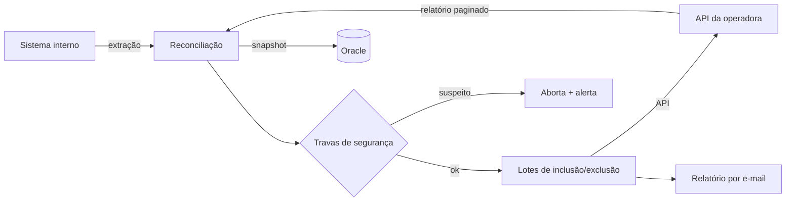

# Sincronização diária de cadastro com operadora de saúde

## Contexto
A empresa mantém o cadastro de beneficiários do plano de saúde no sistema
interno, mas a operadora mantém a própria base. Toda inclusão ou exclusão
precisava ser replicada manualmente na operadora, em lotes.

## Problema
- Duas bases com ~90 mil registros cada, que divergiam diariamente
- Conferência manual lenta e sujeita a erro
- Risco alto: um erro de cruzamento pode cancelar o plano de alguém indevidamente

## Solução
Robô diário que extrai as duas bases, calcula a diferença e gera e envia os
lotes de inclusão e exclusão pela API da operadora.

## Decisões técnicas
- **Cliente REST com OAuth:** o token é renovado automaticamente antes de expirar
- **Relatório assíncrono:** o cliente consulta o status (com timeout) e depois lê
  o resultado em páginas de 1.000 registros
- **Parser tolerante:** corrige respostas JSON malformadas da API
- **Travas contra movimentação em massa:**
  - aborta se qualquer base vier abaixo do volume mínimo esperado
  - detecta qual layout o arquivo de entrada usa antes de ler (layout errado
    zeraria as chaves e geraria cancelamentos em massa)
  - nunca cancela quem falhou no mapeamento de plano
- **Enriquecimento de endereço:** município abreviado é corrigido via API
  pública de CEP, com 10 consultas paralelas e um cache que aprende entre
  execuções. Conflitos vão para revisão humana.
- **Gravação transacional:** DELETE + INSERT na mesma transação, numa thread
  separada, para não travar o fluxo principal
- **Separação de ambientes:** dev/hml geram os lotes, só produção envia

## Stack
Python · pandas/NumPy (vetorizado) · requests · SQLAlchemy + oracledb ·
ThreadPoolExecutor · Azure Key Vault

## Resultado
- ~90 mil registros conciliados por execução, diariamente
- [__] horas/mês de trabalho manual eliminadas
- [__] lotes enviados por mês

**Técnica demonstrada em:** `conciliador-api` *(em breve)*
