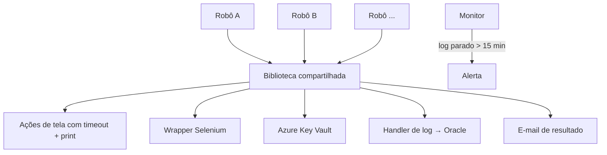

# Biblioteca RPA compartilhada

## Contexto
Cada robô novo reescrevia login em sistemas, cliques, envio de e-mail e
organização de arquivos. Bugs corrigidos num robô continuavam nos outros.

## Solução
Biblioteca Python interna, usada como dependência por todos os robôs, com
12 módulos: automação de tela, navegador, ERPs, e-mail, log, segredos e
monitoramento.

## Decisões técnicas
- **Toda ação de tela tem timeout:** ao estourar, salva um print, registra o
  caminho no log e fecha as janelas
- **Handler de logging customizado:** cada evento vai para uma tabela no banco
  com nome do robô, nível e print anexo, o que permite auditoria sem abrir
  o servidor
- **Segredos fora do código:** credenciais lidas do Azure Key Vault
- **Monitoramento:** verifica os logs de 4 áreas × 2 ambientes e alerta quando
  um servidor para de registrar atividade
- **Configuração por ambiente** via variáveis de ambiente

## Stack
Python · Selenium · PyAutoGUI · pywinauto · OpenCV · Tesseract · cx_Oracle ·
Azure Key Vault · smtplib

## Resultado
- Base de 7+ robôs em produção
- ~1.050 imagens de referência para automação visual
