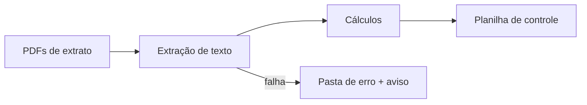

# Extração de extratos de fundos de investimento

## Contexto
Todo mês a controladoria recebia extratos em PDF de vários fundos e
digitava os valores numa planilha de controle para calcular rentabilidade
e patrimônio.

## Solução
Robô que lê todos os PDFs, extrai os saldos, calcula os indicadores e cria
a coluna do novo mês na planilha, preservando fórmulas e formatação.

## Decisões técnicas
- **Cálculos derivados:** movimentação = aplicado − resgatado; despesa
  administrativa = IOF inicial − IOF final; rentabilidade = despesa + valorização
- **Excel sem quebrar:** ao criar a coluna do mês, as fórmulas são traduzidas
  para a nova posição (`openpyxl.formula.translate`), e fonte, borda e
  formato numérico são copiados
- **Isolamento de falhas:** um PDF com problema vai para a pasta de erro sem
  interromper o lote
- **Histórico:** cópia mensal da planilha antes de cada alteração

## Stack
Python · PyPDF · pandas · openpyxl
