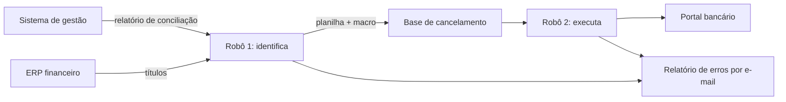

# Cadeia de cancelamento de boletos

## Contexto
Quando um plano era cancelado, os boletos futuros continuavam emitidos no
banco. Cancelar exigia cruzar o sistema de gestão, o ERP financeiro e o
portal bancário.

## Solução
Dois robôs encadeados: o primeiro identifica o que cancelar, o segundo
executa no banco.

## Decisões técnicas
- **Janela de dias úteis** calculada automaticamente
- **Idempotência:** itens já cancelados são registrados e ignorados em novas
  execuções
- **Classificação de erros:** separa "vencimento futuro, aguardar" de "erro
  desconhecido", e só o segundo vira alerta
- **Progresso salvo linha a linha:** se cair no meio, nada se perde
- **Orquestração híbrida:** automação desktop, macro VBA disparada pelo robô
  e automação web

## Stack
Python · pandas · PyAutoGUI · Selenium · VBA

## Resultado
- 3 sistemas integrados sem intervenção manual
