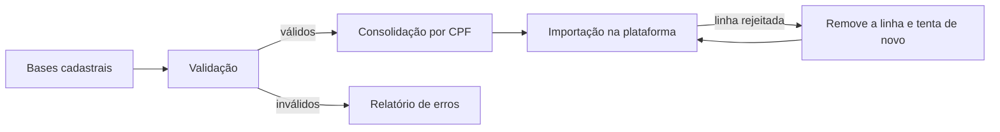

# Higienização de contatos de cobrança

## Contexto
A plataforma de cobrança precisava dos e-mails atualizados dos pagadores,
mas a base cadastral tinha e-mails inválidos, duplicados e placeholders.

## Solução
Robô que extrai as bases cadastrais, valida e consolida os contatos e
importa na plataforma, isolando os registros problemáticos.

## Decisões técnicas
- **Validação em camadas:** regex de formato + lista de domínios permitidos +
  bloqueio de placeholders
- **Consolidação:** vários e-mails do mesmo CPF viram um campo único
- **Importação autocorretiva:** quando a plataforma rejeita o arquivo, o robô
  lê o número da linha no retorno, move o registro para a base de erros e
  reenvia até a importação passar

## Stack
Python · pandas · Selenium · regex

## Resultado
- Execução 3× por semana via agendador
