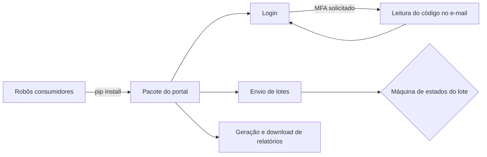

# Pacote Python para automação de portal de operadora

## Contexto
Vários processos precisavam interagir com o mesmo portal web de uma operadora
de saúde: login com MFA, troca de contratante, envio de lotes e download de
relatórios. Cada robô repetia essa lógica.

## Solução
Pacote Python instalável via `pip`, que encapsula todas as interações com o
portal numa classe reutilizável por qualquer robô.

## Decisões técnicas
- **Distribuição como pacote:** `setup.py` com versionamento, consumido como
  dependência pelos robôs
- **MFA automatizado:** o código enviado por e-mail é lido da caixa de entrada,
  filtrando pelo horário da tentativa de login
- **Máquina de estados com `match/case`:** acompanha o lote (em validação,
  pendente de envio, erro de validação, registrado) e toma a ação certa
  em cada estado
- **Recuperação de falhas do servidor:** detecta a tela de erro, recarrega e
  repete a operação
- **Timeouts em toda espera:** 5 min para navegação, 20 min para relatório,
  30 min para validação de lote

## Stack
Python · Selenium · setuptools · integração com e-mail corporativo

## Resultado
- Reutilizado como dependência por outros robôs
- [__] execuções por mês sem intervenção para MFA

**Técnica demonstrada em:** `rpa-toolkit` *(em breve)*
