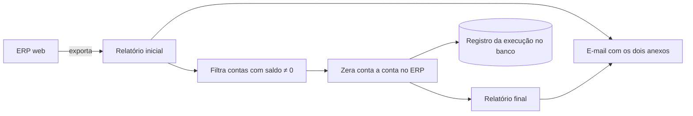

# Zeragem de saldos em ERP web

## Contexto
Diariamente, contas com saldo residual precisavam ser zeradas manualmente no
ERP, uma a uma, com relatórios de antes e depois para conferência.

## Solução
Robô que exporta o relatório inicial, identifica as contas com saldo, zera
cada uma no ERP e exporta o relatório final, enviando os dois por e-mail.

## Decisões técnicas
- **Automação de Web Components:** navegação em Shadow DOM, que o Selenium
  não alcança por padrão
- **Parser de XML de planilha:** converte o formato XML do Excel 2003 exportado
  pelo ERP em `.xlsx`, validando estrutura e cabeçalhos
- **Espera inteligente:** aguarda o fim da exportação pelo sumiço do painel de
  progresso (até 2 h) em vez de `sleep` fixo
- **Rastreabilidade:** resultado de cada execução gravado no banco, arquivos
  movidos para um histórico por data

## Stack
Python · Selenium · pandas · xml.etree · Oracle

## Resultado
- Execução diária automática
