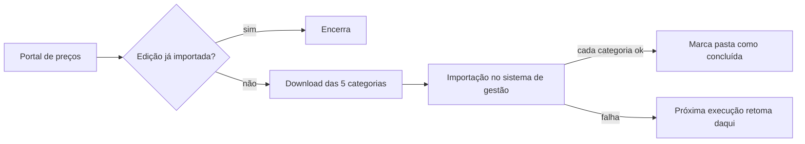

# Atualização de tabela de preços de medicamentos

## Contexto
A cada nova edição de uma tabela de referência de preços, a área de saúde
precisava baixar 5 categorias de arquivos (medicamentos, restritos
hospitalares, oncológicos, dietas e materiais) e importá-las no sistema de
gestão de planos, num processo longo e manual.

## Solução
Robô que detecta se há edição nova, baixa todas as categorias e importa uma a
uma no sistema de gestão, retomando de onde parou em caso de falha.

## Decisões técnicas
- **Idempotência por convenção de pasta:** cada categoria importada recebe o
  sufixo "- sucesso"; a próxima execução pula o que já foi feito
- **Verificação prévia:** compara a edição publicada com o histórico antes de
  baixar qualquer coisa
- **Ordem de importação controlada:** sequência definida por regra de negócio,
  independente da ordem das pastas
- **Esperas longas monitoradas:** importação pode levar horas; o robô
  acompanha o status com tempo-limite de 12 h
- **Credenciais no Azure Key Vault**

## Stack
Python · PyAutoGUI (automação visual) · Azure Key Vault · área de trabalho remota

## Resultado
- 5 tabelas atualizadas por edição sem intervenção manual
