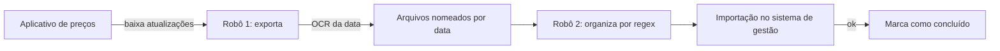

# Atualização de tabela de preços de materiais com OCR

## Contexto
Uma tabela de preços de materiais médicos recebe atualizações periódicas num
aplicativo desktop. Elas precisavam ser baixadas, exportadas e importadas no
sistema de gestão de planos.

## Solução
Dois robôs encadeados: o primeiro atualiza o aplicativo e exporta as
mensagens novas; o segundo organiza os arquivos e importa no sistema de gestão.

## Decisões técnicas
- **OCR para ler dado da tela:** a data de cada mensagem só existe visualmente;
  o robô captura a região, aplica filtro de nitidez com OpenCV e extrai o
  texto com Tesseract
- **Organização por regex:** arquivos são validados pelo padrão de nome e
  movidos para pastas por data
- **Idempotência:** mesmo esquema de pasta "- sucesso" para retomar sem
  reimportar
- **Recuperação de travamento:** detecta erro de violação no aplicativo e
  encerra o processo pelo gerenciador de tarefas

## Stack
Python · PyAutoGUI · OpenCV · Tesseract (pytesseract) · regex

## Resultado
- Atualizações processadas sem digitação manual
- [__] atualizações importadas por mês

**Técnica demonstrada em:** `rpa-toolkit` *(em breve)*
