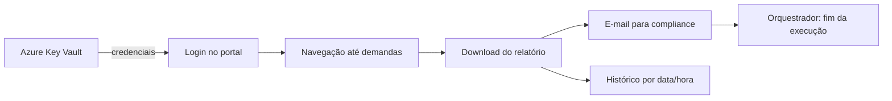

# Coleta diária de demandas regulatórias

## Contexto
A área de compliance precisava acompanhar diariamente as demandas pendentes
de resposta num portal de agência reguladora, acessando e baixando o
relatório manualmente.

## Solução
Robô que acessa o portal, baixa o relatório de demandas aguardando resposta
e envia para a área responsável por e-mail.

## Decisões técnicas
- **Integração com orquestrador:** reporta sucesso ou falha via API do
  orquestrador de robôs
- **Download resiliente:** se o arquivo não vier com o nome esperado, busca o
  mais recente na pasta com novas tentativas
- **Navegação em menus dinâmicos:** dispara eventos de hover via JavaScript e
  troca de iframe
- **Limpeza garantida:** bloco `finally` move arquivos para o histórico,
  fecha o navegador e envia o e-mail mesmo em caso de erro

## Stack
Python · Selenium · Azure Key Vault · API de orquestração

## Resultado
- Execução diária, sem acesso manual ao portal
- [__] demandas acompanhadas por mês

**Técnica demonstrada em:** `rpa-toolkit` *(em breve)*
