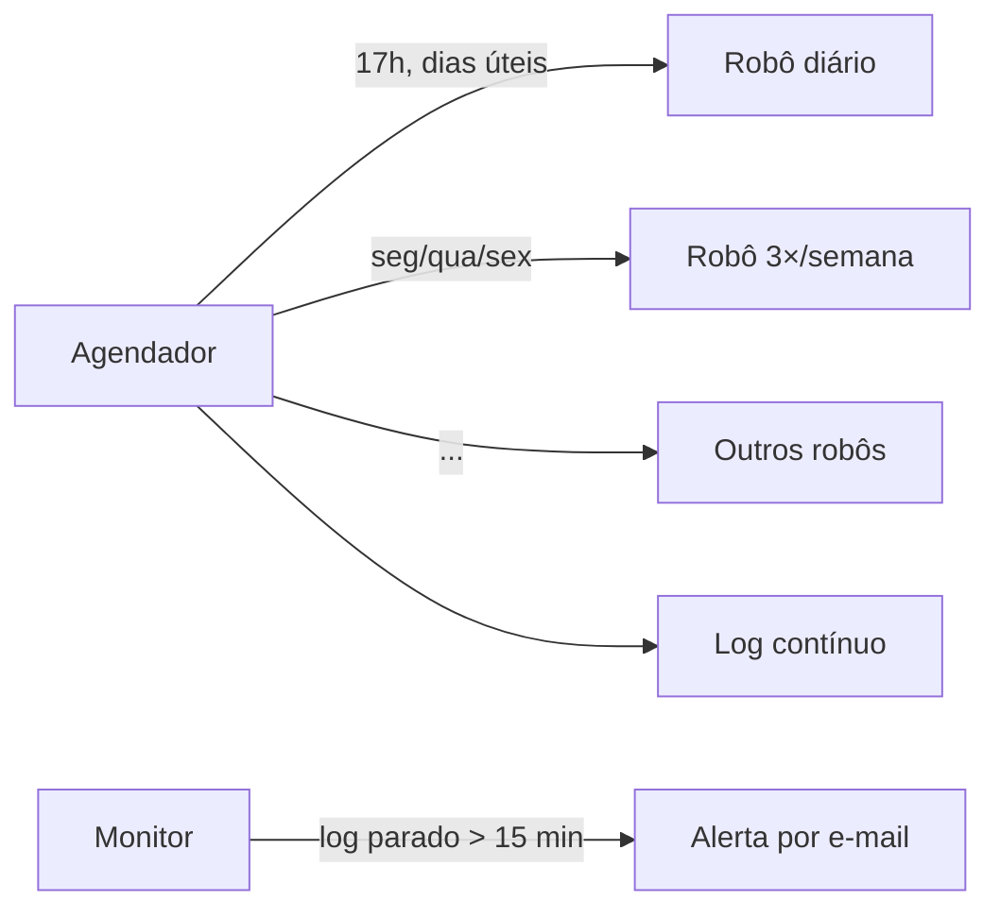

# Agendador de robôs

## Contexto
Antes da adoção de um orquestrador, os robôs precisavam rodar em horários
fixos num servidor dedicado, sem ferramenta de agendamento centralizada.

## Solução
Serviço Python que agenda e dispara cada robô como um processo separado,
com regras por dia da semana, combinado a um monitor que alerta quando o
servidor para de registrar atividade.

## Decisões técnicas
- **Isolamento por processo:** cada robô roda via `subprocess`, então a falha
  de um não derruba o agendador
- **Regras de calendário:** execução diária, semanal ou em dias específicos,
  pulando fins de semana
- **Heartbeat:** o log contínuo permite que o monitor detecte servidor parado
  e alerte a operação

## Stack
Python · schedule · subprocess

## Resultado
- 7 robôs agendados num único serviço
- Alerta automático de indisponibilidade
